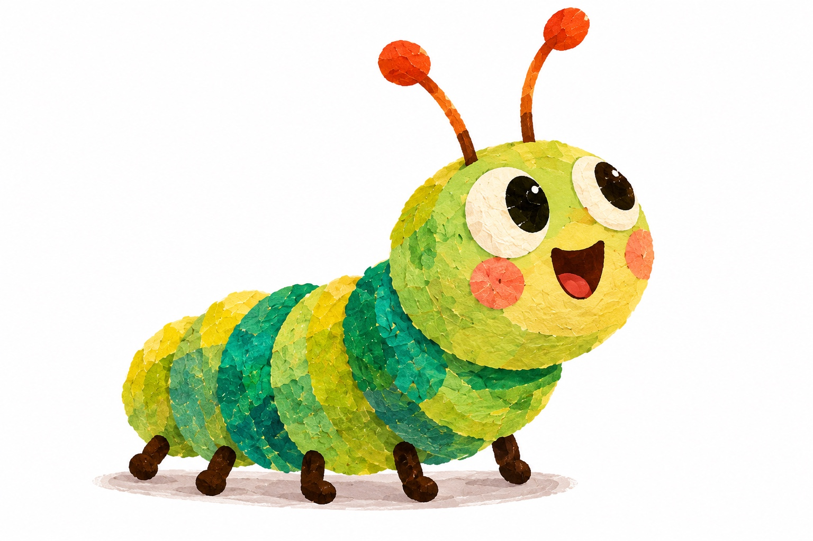
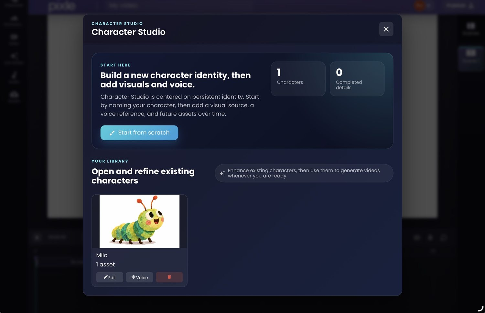
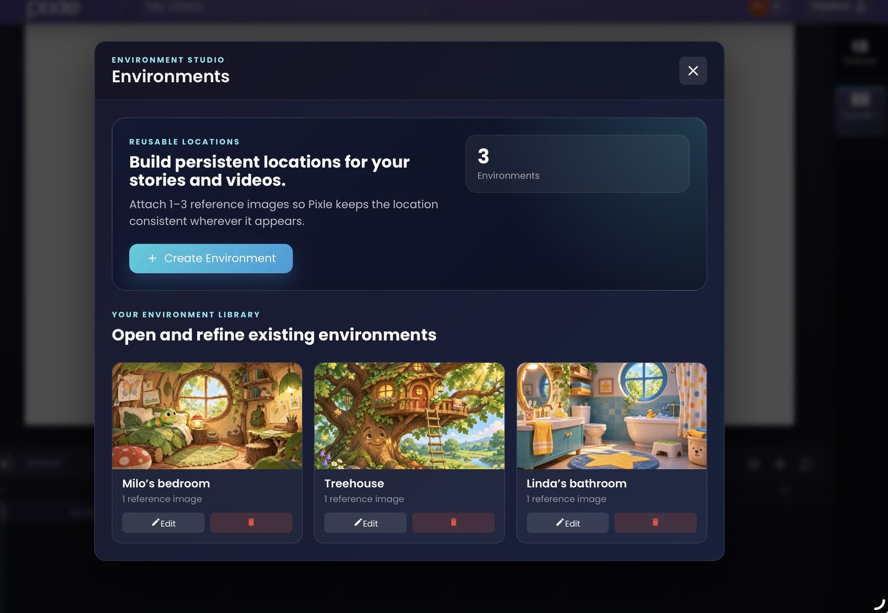
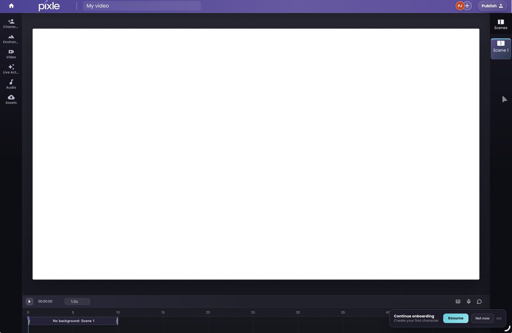
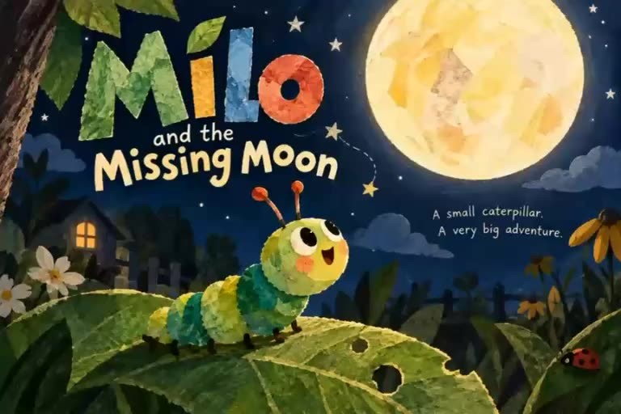

# AI Animation vs Traditional Animation: Cost and Workflow

**Which approach makes more sense for your next animated video? A practical comparison of budgets, production steps, creative control and the hidden cost of revisions.**

*By the Pixle Team · 11 November 2026 · Animation production and budgeting guide · Approximately 9-minute read*

A creator has an idea for a two-minute animated story. The characters are designed, the script is ready, and the next decision is how to produce it. Should they commission a traditional animation team, use AI animation software, or combine both?

It is tempting to reduce the answer to **price per minute**. But a quoted minute of studio animation and a minute of AI-generated footage are not necessarily the same product. One may include storyboarding, animation, revisions and sound. The other may be a set of raw clips that still need selection, correction and editing.

**The useful comparison is the cost and effort of one finished, approved video—not the cheapest way to produce sixty seconds of moving pictures.**

This guide compares the two workflows, explains where the money goes and shows how an AI-native production workspace like [Pixle](https://www.pixle.pro/) can help creators turn reusable characters and scenes into complete stories.

## The short answer: which is better?

**Traditional animation** is usually the stronger option when a project demands highly specific performance, precise movement, a locked visual style and extensive shot-by-shot art direction. The animator has direct control over the creative decisions, though the amount of time and expense varies enormously by technique.

**AI-assisted animation** can make the first moving version of an idea faster and lower the technical barrier for a small team. It is especially useful for prototypes, independent shorts, some educational videos and creator-led series. But it requires careful references, quality control and potentially costly regeneration.

**A hybrid workflow** is often sensible: keep writing, art direction, storyboarding, editing and final approval in human hands while using AI where it genuinely speeds up production.

| Decision | Traditional animation | AI-assisted animation |
|---|---|---|
| First visual draft | Often built through boards, animatics and production work | Often possible to generate test shots quickly |
| Precise acting and timing | Strong direct control with the right animators and technique | Can be variable; complex actions may need more attempts |
| Character and background continuity | Controlled through approved models, rigs, layouts and art direction | Supported by references and saved assets, but still needs review |
| Main production costs | People, specialist work, studio overhead and revisions | Tools/credits, repeated generations, direction, editing and finishing |
| Targeted revisions | May allow precise changes to editable scene elements | May require regenerating all or part of a shot |
| Reuse across episodes | Rigs, backgrounds and libraries can reduce later costs | Character references, environments and prior assets can reduce setup |
| Best fit | Exacting performance, premium production and complex art direction | Testing, small-team storytelling and faster experimentation |

*These are tendencies, not absolute rules. Traditional workflows include efficient rigged and cut-out animation; AI tools and their editing capabilities are changing quickly.*

## 1. What does traditional animation actually cost?

Traditional animation does not have one universal price. A simple motion-graphics explainer, a rigged 2D children's series and a hand-drawn character film need different teams, assets and production hours.

As one published UK studio benchmark, **Motion The Agency estimates roughly £1,500–£8,000 or more per finished minute of professionally produced 2D animation**, depending on style and scope. The studio notes that character performance, detailed illustration, lip-sync, number of scenes and revision rounds affect the budget. This is a commercial 2D-production estimate, not an industry-wide average or a quote for every children's animation project. [Source: Motion The Agency, December 2025](https://www.motiontheagency.com/blog/how-much-does-2d-animation-cost).

Another UK studio, **Flying Duck Studio Lab**, publishes indicative per-minute prices that range from **£4,300 for simple 2D work to £17,500 for complex 2D animation**, with more elaborate traditional work higher still. Different studios define their service tiers differently, so these figures should not be combined into an average. [Source: Flying Duck Studio Lab](https://flyingduckstudiolab.co.uk/animation-studio-services/2d-animation).

What are you paying for? Usually, some combination of:

- **Pre-production:** script development, character design, visual development, storyboards and an animatic.
- **Production:** layouts, backgrounds, rigging or drawings, character animation, effects and compositing.
- **Post-production:** editing, voice recording, sound design, music, colour finishing and delivery.
- **Management and revisions:** creative reviews, feedback rounds, file organisation and approvals.

[Toon Boom's animation-pipeline documentation](https://helpcentre.toonboom.com/hc/en-ca/articles/57086299380371-About-the-Animation-Pipeline) describes these three broad phases—pre-production, production and post-production—even though the precise steps depend on the animation technique.

**Important:** Traditional animation can become more economical over a series. A studio that has already built reusable character rigs, backgrounds and props does not necessarily recreate everything for episode two.

## 2. What does AI animation cost?

AI animation shifts where some of the work happens. You may no longer need a specialist to draw or animate every shot from scratch, but you still need to decide what the scene should show, prepare visual references, generate candidates, inspect results and edit them into a coherent story.

The costs typically fall into five buckets:

1. **Generation:** video model usage, credits or subscription charges. Prices may depend on the model, clip length, quality and output settings.
2. **Iteration:** alternate takes, rejected generations and changes to scenes that do not meet the brief.
3. **Creative work:** scripting, planning, prompting, character design and directing.
4. **Finishing:** editing, dialogue, music, effects, continuity fixes, subtitles and export.
5. **People and licensing:** creator time, collaborators, professional audio, stock assets and any necessary rights.

The most common budgeting mistake is to use the price of *one successful generation* as the cost of *one finished minute*. In real production, some generations will be rejected, shortened, repeated or edited away.

### An illustrative two-minute AI animation budget

Suppose you plan a **120-second finished story** made from **15 shots averaging 8 seconds each**. If you generate an average of **two versions per shot**, your raw output is **240 seconds, or four minutes**, before editing.

For illustration only, assume a **hypothetical generation rate of $45 per minute of raw output**. That is an example rate for a budget model, **not a verified Pixle price or a promise of what a particular model costs today**.

| Budget line | Assumption | Example cost |
|---|---|---:|
| AI video generation | 4 raw minutes × hypothetical $45/min | $180 |
| Creative planning, review and editing | 12 hours × illustrative $30/hour | $360 |
| Audio and other licensed assets | Illustrative allowance | $50 |
| **Illustrative total** | **For this example only** | **$590** |

That is **$295 per finished minute** in this particular model. It is not a market benchmark. Changing the number of attempts, hourly rate, audio needs or model price changes the result immediately. It also excludes expenses such as taxes, one-off hardware, broader business overhead and any extra revisions not included in the example.

**A simple formula:**

`Total cost = (raw generated minutes × generation rate) + (human hours × hourly cost) + audio/licensing + other expenses`

If you only count the $180 generation bill, you understate the actual project cost by $410 in this example.

## 3. Traditional vs AI: how the workflow differs

The phases of production don't disappear with AI. What changes is **how each phase is executed**, how quickly you can test ideas and how much control you have over revisions.

### Traditional animation workflow

**Script → storyboards → character and environment design → animatic → layouts/rigging or drawings → animation → compositing → sound and edit → final delivery.**

Because many of the elements are built as editable production assets, a team may be able to adjust a specific pose, mouth shape, keyframe or background independently. That control matters when the creative brief is precise.

### AI-assisted animation workflow

**Script → scene and shot plan → approved character/environment references → generate test shots → review and regenerate → assemble the timeline → audio and final polish → delivery.**

The first candidate may arrive quickly. But a clip is not finished just because a model generated it. You still need to check whether the character looks right throughout the shot, the action follows the script and adjacent scenes feel like one film.

AI can shorten some animation tasks. It does not remove writing, directing, reviewing or editing.

## 4. A real Pixle example: Milo and the Missing Moon

To make this less abstract, consider **Milo**, the green-and-yellow caterpillar featured in the short animated film *Milo and the Missing Moon*. The film and product screenshots below are actual Pixle demonstration materials. **We are not presenting an audited production budget or claiming the film cost the hypothetical amount above.**

### Save the character once

*Pixle Character Studio shows Milo as a reusable character, with controls for visual assets and voice references.*

Pixle's **Character Studio** lets creators keep a persistent character identity rather than describing the same character from scratch every time. That helps when a short story needs several scenes—or when a YouTube creator wants to bring the same character into a future episode.

### Reuse environments

*Saved locations such as Milo's bedroom and treehouse provide a reference point for repeated settings.*

The **Environment Studio** supports reusable visual locations. This reduces repetitive setup, but the generated footage still needs to be inspected for differences in layout, lighting and details.

### Assemble and refine the finished story

*Pixle's Creative Editor includes a timeline for arranging scenes and working with the final sequence. The screenshot shows a workspace, not a completed Milo timeline.*

Pixle combines scene generation, reusable assets and an editing timeline in one workspace. The value is not just generating a clip: it's retaining the characters and worlds while organising the work of making a story.

**Watch an actual animated example:**

**[Milo and the Missing Moon — finished animated short (MP4)](assets/milo-and-the-missing-moon.mp4)**

The finished film shows how an animated character can feature across shots and changes of composition. It is a creative example, not evidence of a particular cost saving or production speed.

## 5. Where AI animation can save time—and where it can cost more

**AI can help when:**

- You're testing multiple visual directions before committing to a full production.
- You're an independent creator without a full animation department.
- Your scenes are relatively short, and you can review results shot by shot.
- You're building a recurring series and can reuse approved references and environments.
- Your goal is a good finished story, rather than frame-perfect control of every character movement.

**AI may become less economical when:**

- A complex action repeatedly fails and needs many regenerations.
- Dialogue requires very specific lip movement and performance.
- A client needs precise, small revisions to a finished shot.
- A long sequence has many interacting characters or difficult continuity requirements.
- The production must meet stringent technical, legal, style or pipeline requirements.

An AI-assisted film may produce a great result on the first or second attempt—or require extensive reworking. **Track your acceptance rate**: of all the footage you generate, how many seconds actually make it into the final edit?

## 6. How to choose: a simple production decision guide

| Your situation | What to consider first |
|---|---|
| Solo YouTube creator starting a recurring series | AI-assisted workflow with a strong character library and review process |
| Small studio pitching a new character or programme | AI for concept tests, boards and early animation; human creative direction |
| Established series with strict designs and approvals | Traditional or hybrid pipeline, depending on the tolerance for variation |
| Branded explainer with exact timing and on-screen text | Compare professional motion design with AI-assisted options |
| Complex expressive animation with nuanced acting | Strong case for experienced animators and a controllable pipeline |
| Children's educational shorts with repeatable settings | Test AI-assisted production while protecting clarity, safety and continuity |

Rather than asking whether AI replaces traditional animation, ask: **Which parts of this project benefit from generation, and which parts need direct artistic control?**

## 7. Five questions to ask before calculating your budget

1. **What is the finished duration?** Budget for approved runtime, not merely generated footage.
2. **How many distinct shots and characters?** More shots, interactions and locations often mean more planning and review.
3. **How many attempts are you allowing?** Model costs multiply if most shots need repeated generation.
4. **What finishing work is included?** Dialogue, mixing, music, sound effects, subtitles and revisions should all be counted.
5. **Can assets be reused later?** A recurring series may justify a larger first-episode investment in characters and environments.

A useful starting practice is to produce **one representative 10–20-second sequence** before budgeting an entire episode. Track the actual credits, number of attempts and hands-on time. Those numbers are more meaningful than a generic claim about how much animation costs.

## Frequently asked questions

### Is AI animation always cheaper than traditional animation?

No. AI can substantially reduce some production costs, but its total cost depends on the quality target, number of generations, human review, finishing and licensing. Traditional workflows can also be cost-effective when reusable character rigs and backgrounds already exist.

### How much does a minute of AI animation cost?

There isn't one reliable universal rate. Raw-generation prices differ by product, model and plan, and a finished minute may require several minutes of raw footage plus editing and sound. Use your actual generation rate and acceptance rate to calculate a project budget.

### Is traditional animation more consistent?

Traditional production pipelines offer direct control over approved character models, drawings, rigs and revisions. AI workflows can support continuity using reference assets, but results still need careful checking.

### Can AI animation be used for a professional YouTube series?

Yes, provided the creator can maintain story quality, character continuity, rights clearance and an achievable schedule. A reusable production library can make recurring videos easier to manage.

### Should creators use AI or hire animators?

It depends on the intended look, budget, schedule and level of control. Creators can use both: AI for exploratory work or selected shots, and experienced artists for precise design, animation, editing and final polish.

## The real shift: from generating clips to producing stories

The biggest benefit of AI animation is not a single attractive short clip. It's the possibility of giving more creators the tools to make **repeatable animated stories**, without having to rebuild their entire production process for each new episode.

Pixle is designed for that longer workflow: save characters in **Character Studio**, bring back locations through **Environment Studio**, generate scenes and edit them together in the **Creative Editor**. A creator still decides what the story means and whether the result is good enough to publish.

**[Start creating animated stories with Pixle](https://app.pixle.pro/)**

### Continue learning

- [How to Create Consistent AI Characters Across Animated Scenes](https://www.pixle.pro/blog/consistent-characters/)
- [How to Make an Animated YouTube Series Using AI](https://www.pixle.pro/blog/animated-youtube-series/)
- [How to Turn a Script into an Animated Video](https://www.pixle.pro/blog/script-to-animated-video/)
- [How to Create Recurring Animated Characters](https://www.pixle.pro/blog/recurring-animated-characters/)

### Sources and methodology

Published studio prices above are **indicative quotes from individual UK providers**, not surveyed global averages; they may exclude particular services or differ by project. The AI budget table is **an original hypothetical scenario** and not a Pixle rate card, actual project invoice or audited industry average. Production workflows were cross-checked against Toon Boom's educational documentation.

- [Toon Boom — About the Animation Pipeline](https://helpcentre.toonboom.com/hc/en-ca/articles/57086299380371-About-the-Animation-Pipeline)
- [Motion The Agency — How Much Does 2D Animation Cost and How Long Does It Take? (2025)](https://www.motiontheagency.com/blog/how-much-does-2d-animation-cost)
- [Flying Duck Studio Lab — 2D Animation Services and Indicative Pricing](https://flyingduckstudiolab.co.uk/animation-studio-services/2d-animation)
- [Pixle — Product Overview](https://www.pixle.pro/)

*About the author: The Pixle Team develops an AI-native animation workspace for creators building characters, story worlds and animated videos. This guide is intended to help creators plan projects and compare workflows; actual costs and results will vary.*
