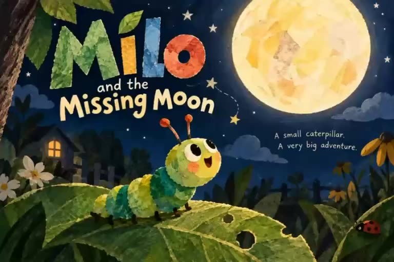
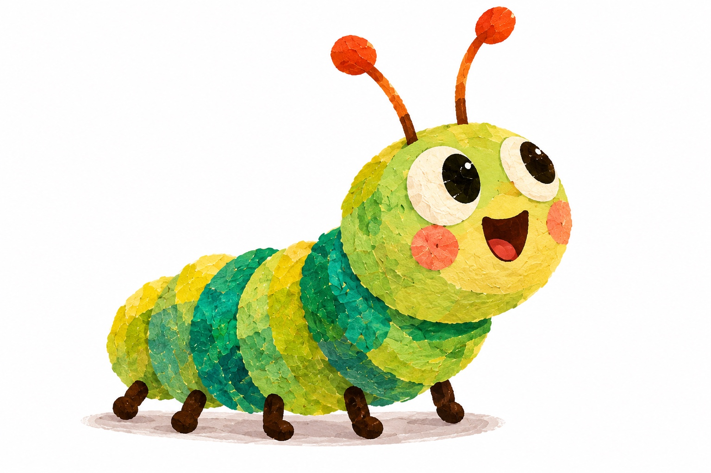
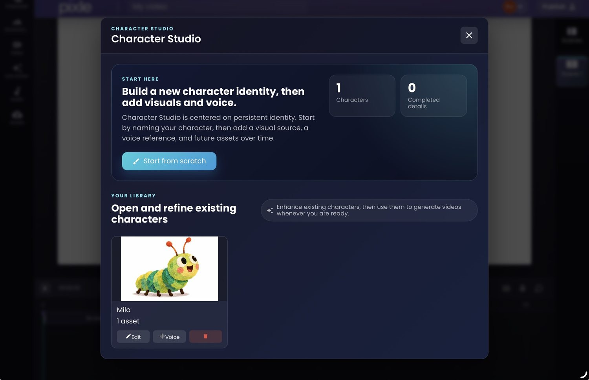
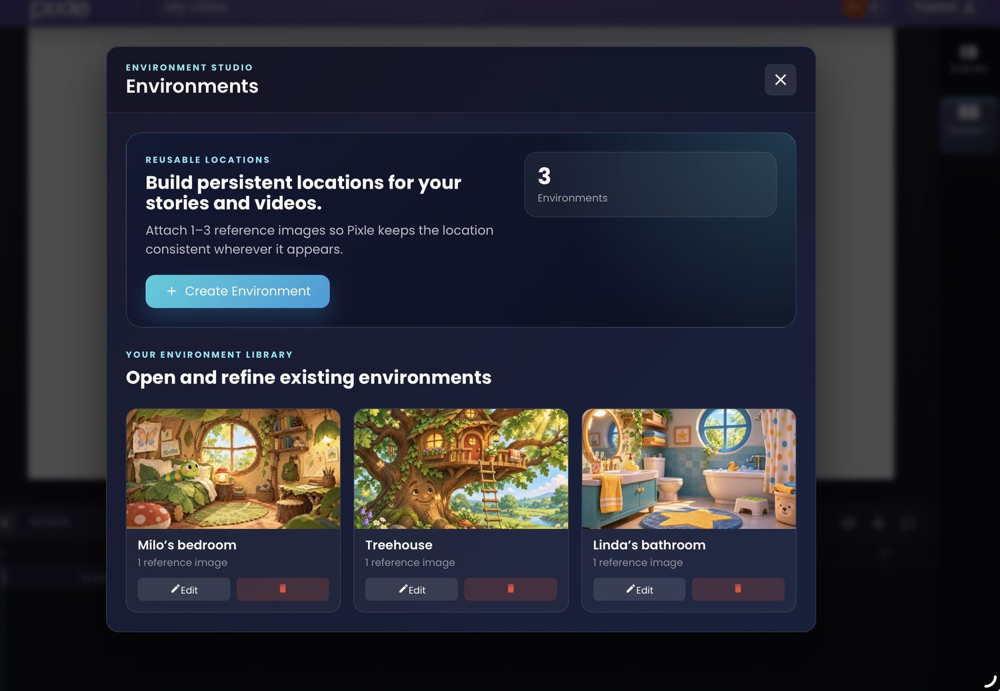
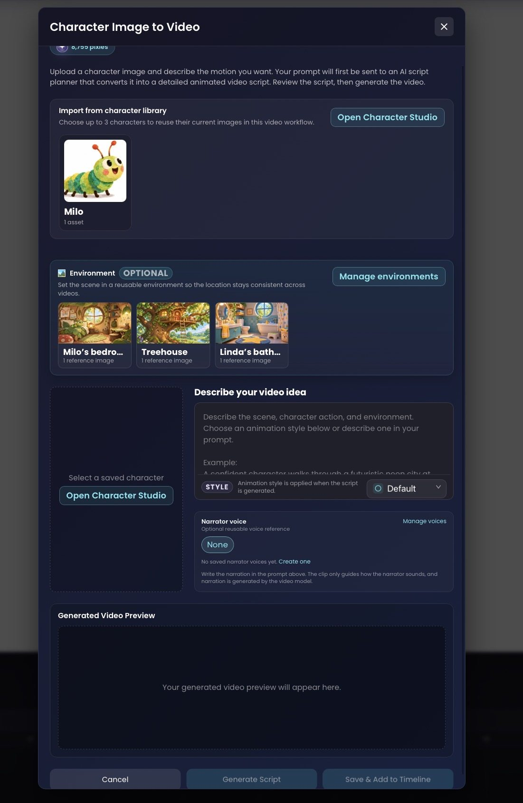
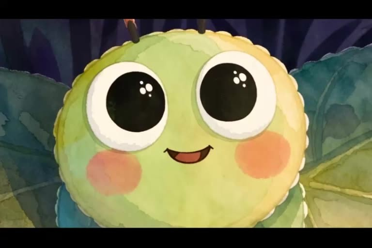
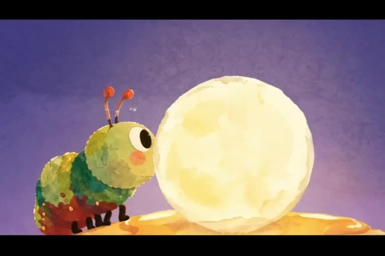
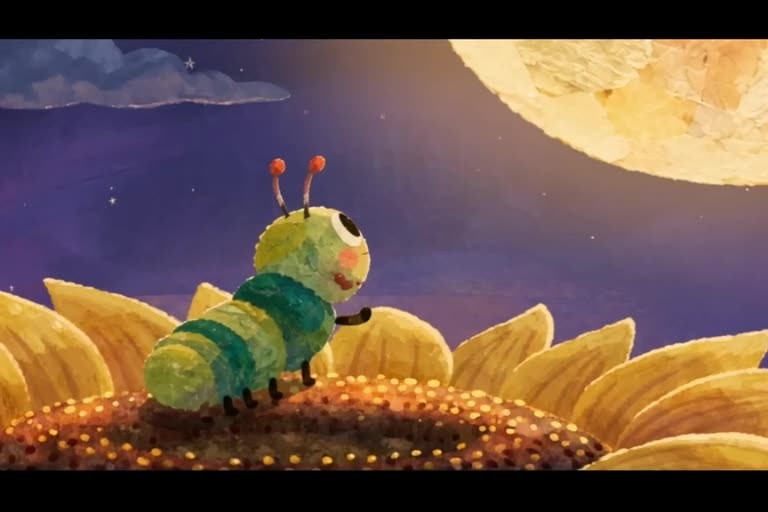
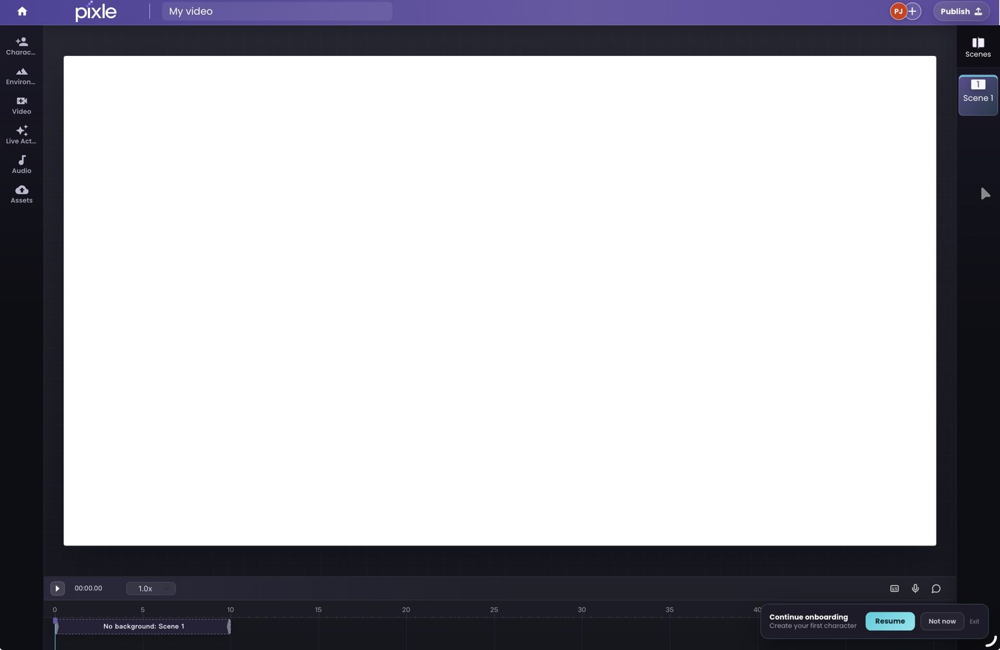
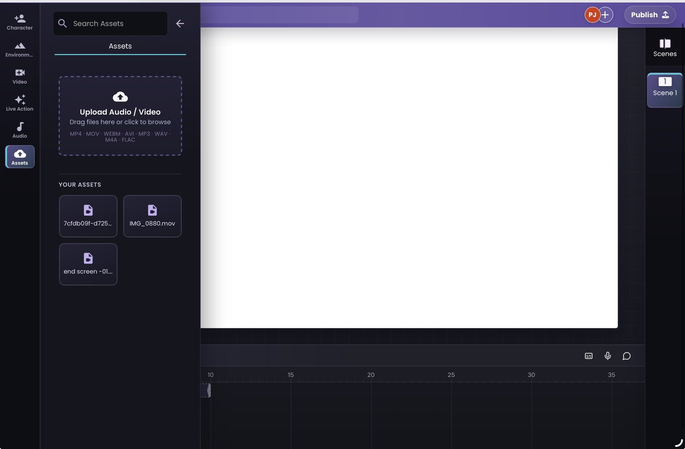

URL: https://www.pixle.pro/blog/ai-animated-youtube-series
Meta description: Learn how to plan, create and publish an animated YouTube series using AI. A practical episode workflow with reusable characters, environments and Pixle screenshots.

Animation tutorial · YouTube series production

# How to Make an Animated YouTube Series Using AI

Build a world, not just a clip. Here is a practical workflow for taking an original series idea from pilot script to repeatable animated episodes.

By the Pixle Team · Illustrated with real Pixle interface screenshots and the animated short *Milo and the Missing Moon*



You have an idea for an animated YouTube channel: a little caterpillar who discovers the world, a group of musical animals, or an educational series featuring the same characters every week. Creating the first video is exciting. Creating a *series* is a different challenge.

Episodes need recognisable characters, familiar locations, a consistent visual style, a workable production process and enough new stories to keep viewers interested. AI can help produce the visuals, but the story, creative decisions and quality control still matter.

This guide walks through the process using [Pixle](https://www.pixle.pro), an AI-assisted animation workspace, and Milo the caterpillar as our example. You can apply the workflow to children's stories, educational animation or an independently produced cartoon channel.

## 1. Choose a series format before generating anything

Start with a one-paragraph series concept: **Who is it for? Who is the recurring character? What happens in a typical episode? What makes each story different?**

For a fictional Milo series, the answer might be: “Short, warm animated adventures in which Milo discovers something unusual about his world, faces a manageable problem and learns something along the way.”

Then make four production decisions:

**Audience** — Specify who the story is for and the level of language and complexity.

**Episode length** — Choose an achievable pilot length before committing to a season.

**Story structure** — Use a familiar beginning, complication, discovery and resolution.

Do not plan twenty episodes before you know what it takes to finish one. Produce a short pilot and use it to test story pacing, visual continuity, voice quality and editing effort.

## 2. Create a small season plan

A series should have a recognisable identity without repeating the exact same plot. Draft a simple six-episode slate. The following titles are **illustrative ideas**, not claims about released Milo episodes.

| Episode idea | Story question | Recurring asset |
| --- | --- | --- |
| 1. The Missing Moon | Where has the moon gone? | Milo; night-world styling |
| 2. The Treehouse Secret | Who lives beyond the branches? | Milo; treehouse |
| 3. A Rainy Day | How can Milo help a friend? | Milo; bedroom |
| 4. The Lost Leaf | Can Milo find his way home? | Milo; woodland |
| 5. The Garden Concert | What happens when everyone joins in? | Milo; garden characters |
| 6. A New Beginning | How does Milo welcome change? | Milo; returning locations |

The aim is to decide which *creative assets* you will reuse, and which *story elements* will change. This is the foundation for a sustainable animation pipeline.

## 3. Build a character and environment bible

**Milo character reference:** The original green-and-yellow Milo caterpillar used in this tutorial.



Before you generate scenes for Episode 1, define your recurring cast: shapes, colours, expressions, speech patterns, voice references and personality notes. Also establish the places audiences will recognise.

In **Pixle Character Studio**, creators can save a character identity and add visual references and a voice. Here Milo appears in the reusable character library.



**Character Studio:** build and reuse a recognisable character identity instead of recreating it from scratch each episode.

Then use **Environment Studio** to organise recurring locations. The example library below includes Milo's bedroom, a treehouse and a bathroom. Each saved location provides a visual reference for later scenes.



**Environment Studio:** keep recurring locations available across your story-world production.

For more about maintaining character identity, read [How to Create Consistent AI Characters Across Animated Scenes](https://www.pixle.pro/blog/consistent-ai-characters). Publish that companion article before enabling this internal link.

## 4. Write one episode as a sequence of short scenes

Write the pilot first. A simple outline might include an opening hook, the problem, two or three attempts to solve it, and an ending that feels complete. Then break the script into shots you can generate and review separately.

**Example beat sheet for an original Milo episode**

- **Scene 1 — Hook:** Milo notices something surprising outside his bedroom window.
- **Scene 2 — Decision:** He decides to investigate.
- **Scene 3 — Exploration:** He travels to a familiar location, meeting an obstacle.
- **Scene 4 — Discovery:** A clue changes how he understands the problem.
- **Scene 5 — Resolution:** He acts on what he learned and the story ends.

For each scene, write down the location, character reference, action, camera framing, dialogue or narration, sound and intended duration. This makes your instructions more specific and reduces unnecessary trial and error.

## 5. Generate scenes using the same reusable assets

Open Pixle's **Character Image to Video** workflow. The interface allows you to choose from your saved characters, select an optional environment, describe the scene, set an animation style and work with narrator-voice references. Its on-screen guidance also describes an intermediate script-planning stage before video generation.



**Character Image to Video:** select characters, environments and scene directions inside a single workflow.

Here is an example of a useful scene prompt:

```
Character: Milo from the saved character library.
Location: Milo's bedroom from the saved environment library.
Action: Milo wakes, looks toward the round window and reacts with surprise.
Camera: Medium shot, then a slow push toward Milo's face.
Style: Keep the same soft illustrated look as the established references.
Audio direction: Gentle morning ambience; narrator introduces the mystery.
```

Generate and review the scenes individually. Reference assets improve continuity, but you should still check eyes, antennae, body proportions, colour, lighting and movement between shots. Do not assume every output will match perfectly.

## 6. Watch a complete animated story

Below is *Milo and the Missing Moon*, a completed animated short supplied for this tutorial. It offers a concrete example of a story with a recurring protagonist, multiple compositions and a complete narrative arc.

[Embedded video: Milo and the Missing Moon — assets/milo-and-the-missing-moon.mp4]

**Milo and the Missing Moon** · 2 min 29 sec. An example of a finished animated short that can help inform the visual and narrative standards of a pilot.



Recognisable expressions



Varied camera angles



Changing compositions

This short demonstrates one finished story, not a catalogue of released episodes or proof that the same character has been reproduced consistently in separately generated videos.

## 7. Edit the episode and establish quality standards

Use your timeline to place scenes in narrative order, check pacing, add dialogue or narration where appropriate, and build sound design around each moment. Pixle has a scene-based editor with a preview canvas and timeline. The screenshot shows an empty project workspace, not an edited finished episode.



**Pixle editor:** the workspace for arranging and reviewing the animated sequence.

For supporting audio and video, the Pixle **Assets** panel provides an upload area and media library.



**Assets library:** keep supporting media available while editing your episode.

Before export or publishing, use a consistent checklist: is the story clear without explanation, are character designs stable, does every scene have the intended sound, are cuts smooth, is the aspect ratio right, and do you have permission to use all music, character designs, imagery and voices?

## 8. Publish the episode on YouTube

Once your finished video is available as an uploadable file, go to [YouTube Studio](https://studio.youtube.com/), choose **Create → Upload videos**, select your file and complete the title, description, thumbnail, audience and visibility settings. You can also schedule its publication. [See YouTube's official upload instructions](https://support.google.com/youtube/answer/57407).

Give the series a consistent title format—for example, “Milo Adventures | Episode 1: The Missing Moon”—and a recognisable thumbnail treatment. Organise released episodes into a playlist so viewers can find them together. [YouTube's playlist guide](https://support.google.com/youtube/answer/57792) explains how to create and manage one.

**If your videos are directed at children, set the audience accurately as “Made for Kids.”** That designation can restrict features such as comments and some recommendations-related tools. [Read YouTube's audience-setting guidance](https://support.google.com/youtube/answer/9527654).

**Check YouTube's AI disclosure guidance, too.** YouTube generally distinguishes obviously non-realistic animation from realistic synthetic or altered content, for which disclosure may be required. Requirements can also depend on other elements, such as AI-generated music. [Review the current disclosure requirements](https://support.google.com/youtube/answer/14328491) for each upload.

## 9. Repeat the workflow without making every episode identical

Once the pilot is complete, reuse the assets that define the series: characters, references, locations, naming conventions and production checklist. For the next episode, change the central story, emotional journey, action and visual ideas.

That balance matters for viewers and for a sustainable channel. YouTube's monetisation guidance specifically warns against mass-produced or highly repetitive content and distinguishes it from recurring-character shows in which individual episodes have meaningfully different narratives. [Read YouTube's monetisation policies](https://support.google.com/youtube/answer/1311392).

**Series-production rule:** reuse your assets, not your ideas. The characters and world can stay familiar while every episode delivers a new story worth watching.

## Frequently asked questions

### Can I make a YouTube animated series using only AI?

You can use AI tools for substantial parts of writing assistance, visual generation, voices and editing, but an effective series still needs human decisions about story, design, pacing, rights and quality.

### How do I keep the same character across episodes?

Save clear visual references, reuse the same character identity, maintain a character bible and compare each output before it goes into an episode. Pixle provides a character library to support this workflow.

### How long should my first animated episode be?

Choose a length you can actually finish and review. A short pilot can be more useful than committing to a long episode before you understand your generation and editing workflow.

### Can AI-generated animation be monetised on YouTube?

AI use alone does not automatically rule out monetisation. Eligibility depends on the applicable YouTube Partner Programme requirements, originality, viewer value and platform policies. Avoid treating repetitive generated output as a substitute for original storytelling.

Start your animated series

## Build the characters once. Tell more stories.

Use Pixle to develop reusable characters, consistent story environments and animated scenes in one creative workspace.

[Start creating with Pixle](https://app.pixle.pro?utm_source=blog&utm_medium=article&utm_campaign=youtube_series)

**About the author:** The Pixle Team develops an AI-assisted animation workspace. This guide is based on real interface screenshots and a supplied Milo animation, with links to YouTube's official publishing policies. The example season slate and scene prompt are illustrative.

### Useful official references

- [YouTube: Upload videos](https://support.google.com/youtube/answer/57407)
- [YouTube: Set your video's audience](https://support.google.com/youtube/answer/9527654)
- [YouTube: AI-generated content disclosures](https://support.google.com/youtube/answer/14328491)
- [YouTube: Channel monetisation policies](https://support.google.com/youtube/answer/1311392)