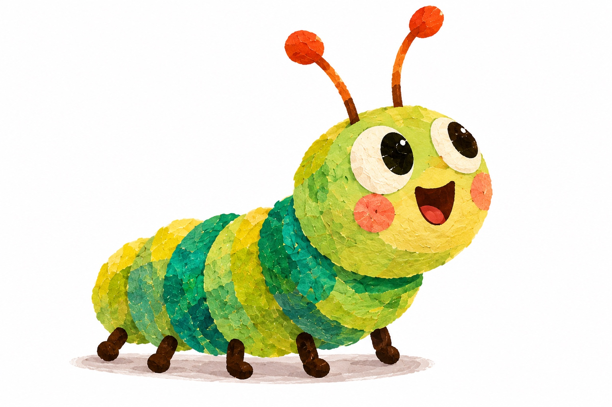
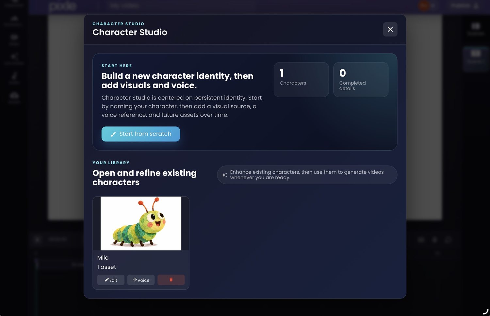
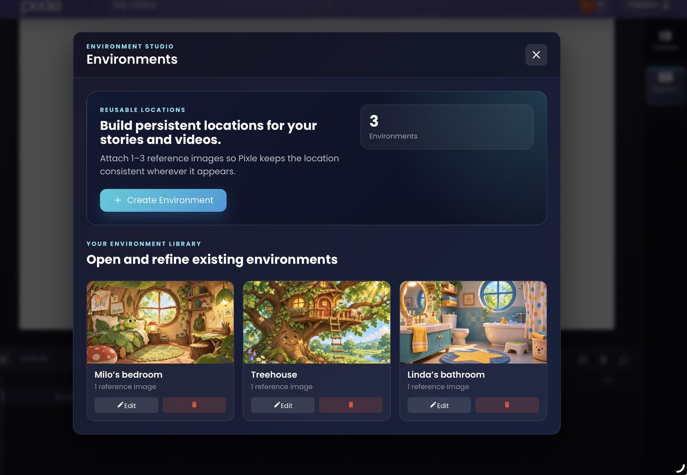
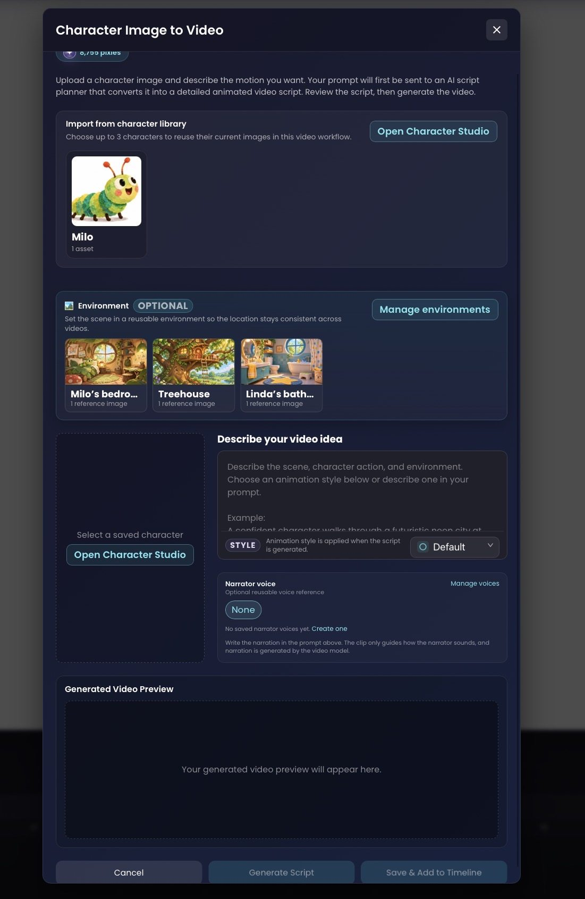
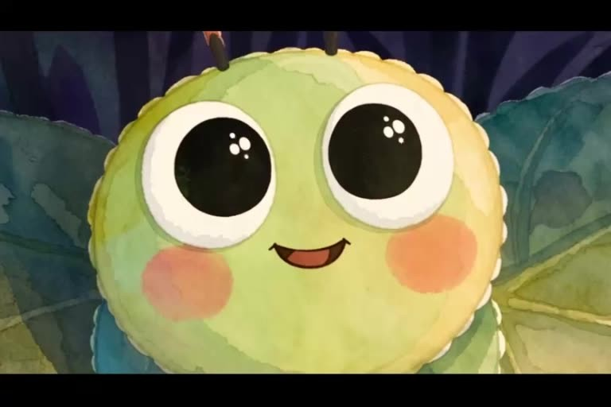
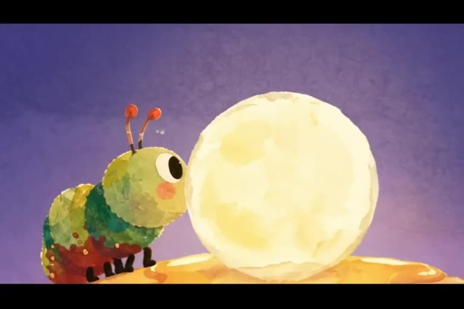
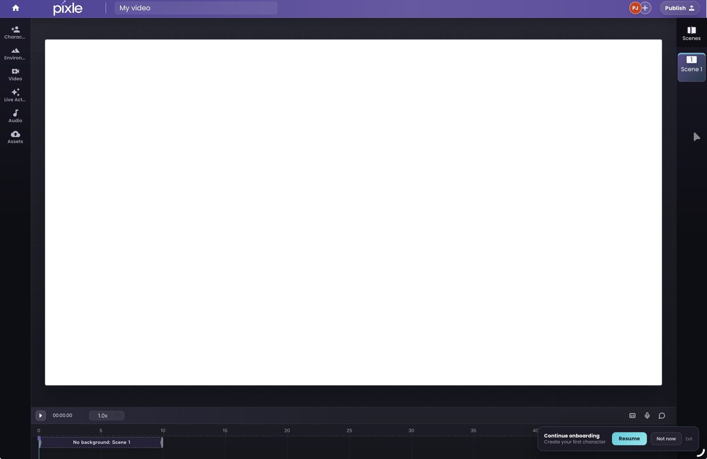

# How to Create Recurring Animated Characters: From One Idea to an Entire Series

**A practical guide to designing characters audiences recognise, remember and want to see again — with an illustrated Pixle workflow featuring Milo.**

*By the Pixle Team · 10 November 2026 · Character development guide*



It's easy to imagine an animated character for one video. The harder—and more interesting—challenge is creating a character who can return in episode two, episode ten and a completely new story without losing what makes them special.

Recurring animated characters do more than look the same. They have a recognisable personality, a consistent voice, a world they belong to and enough room to grow. That combination turns a collection of clips into something viewers can follow.

In this guide, we'll build a repeatable character system using **Milo**, a cheerful green-and-yellow caterpillar, and show how **[Pixle](https://www.pixle.pro/)** can help creators organise the visual assets behind it. The creative examples are illustrative; the product screenshots and *Milo and the Missing Moon* film are real Pixle examples supplied for this guide.

## What makes a good recurring animated character?

A recurring character needs **three kinds of consistency**:

1. **Visual identity:** Viewers recognise the silhouette, colours, proportions and distinctive features.
2. **Character identity:** Viewers understand how the character tends to think, speak, react and make choices.
3. **Story identity:** Viewers know what kind of adventures to expect when that character appears.

The first is an animation-production problem. The second and third are storytelling problems. Strong series solve all three.

Consider Milo. His green-and-yellow segmented body, orange-tipped antennae, big eyes and illustrated texture help make him recognisable. But if he is going to anchor a recurring series, we also need to decide what he wants, what scares him, what makes him curious and how he responds when things go wrong.

**A useful rule:** Design a character that can be described in one sentence, but can carry many different stories.

## 1. Give your character a clear role in the series

Before choosing a visual style, decide what your character *does* for the audience. Is this an adventurous explorer, a gentle teacher, a mischievous problem-solver or an anxious hero learning to be brave?

For an example Milo series, we might write:

> **Character premise:** Milo is a curious little caterpillar who notices things that others miss and finds the courage to explore them—even when he is a little afraid.

This is an **example series premise**, not a claim about the official character backstory in the existing film. It suggests the kinds of episodes Milo could support: a missing moon, a mysterious garden sound, a new neighbour or a path that has suddenly disappeared.

Then define a repeatable story pattern: **Milo notices something unusual → Milo investigates → the adventure teaches him something → Milo returns changed, even if only a little.**

A story pattern is not a formula for identical episodes. It is a promise about the type of experience viewers will get.

## 2. Build a character bible before generating episodes

A **character bible** is a short reference document that makes the creative decisions easy to repeat. It is useful for solo creators and even more valuable when several people work on different episodes.

| Character bible field | Example for Milo |
|---|---|
| Name and role | Milo — curious caterpillar and series protagonist |
| Recognisable features | Green-and-yellow segments, orange-tipped antennae, large eyes, rosy cheeks |
| Visual style | Layered, textured children's-book illustration |
| Personality | Curious, kind, easily surprised, increasingly brave |
| Typical expressions | Wonder, delight, hesitation, relief |
| Voice direction | Warm, bright and inquisitive; choose and save a consistent reference |
| Core world | Bedroom, garden and treehouse |
| Must stay consistent | Main colours, facial features, antennae, proportions and voice identity |
| Can change by episode | Expression, pose, story action, lighting and camera angle |



*The actual Pixle Character Studio interface shows Milo as a saved character with editing and voice controls.*

You don't need a hundred-page production manual. Start with one page and add details only when a new episode reveals something worth preserving.

**Download:** [Editable character bible worksheet](character-bible-template.csv). It includes blank fields and an illustrative Milo row.

## 3. Create one master visual reference—and keep it authoritative

Once your character concept is settled, select the image or reference set that best represents the design. It becomes the **master reference** used to evaluate future artwork.

For Milo, check the details that immediately signal his identity: the shape of his face; the pattern of his body segments; the orange antennae; the expressive eyes; and the layered, picture-book texture.

Useful reference material can include a front view, a side view, two or three facial expressions and a note about colours and proportions. You don't have to generate all of these on day one; the important thing is to decide which references are approved.

In **Pixle's Character Studio**, creators can maintain a reusable character identity and attach visual and voice references. Save the approved character before beginning a sequence of animated scenes, so each new scene can refer back to the same identity.

This does **not** make every AI-generated frame identical. Generative animation can still change features during movement, unusual camera angles or lighting changes. The purpose of a master reference is to give you a reliable standard for spotting—and correcting—those changes.

For a deeper look at visual drift, see [How to Create Consistent AI Characters Across Multiple Videos](https://www.pixle.pro/blog/consistent-ai-characters).

## 4. Give the character a voice, behaviour and a set of rules

A recurring character should sound and behave like themselves, even when the plot changes.

Write three short pieces of guidance:

- **Voice:** How does the character sound? What is their typical pace, energy and emotional range?
- **Behaviour:** What does the character normally do before making a difficult decision?
- **Rules:** What would feel out of character? What traits should the writing preserve?

For example, an illustrative Milo rule might be: *When Milo is scared, he asks a question before running away.* That tiny rule can make reactions consistent across episodes without forcing dialogue to repeat.

Pixle's Character Studio includes voice-reference controls, and its Character Image to Video workflow offers narrator voice settings. Choose appropriate reference material only if you have permission to use the voice or other assets involved.

**Tip:** Keep a few lines of approved dialogue or performance notes in the character bible. These help you review whether new narration and speech feel right, regardless of the generation model you use.

## 5. Build a world the character can return to

Characters become memorable partly because they inhabit recognisable places. A bedroom, a treehouse and a garden can do storytelling work before anybody speaks: the audience already knows what feels familiar and what is new.

In **Pixle's Environment Studio**, creators can save locations as reusable visual references. The example library shown below contains Milo's bedroom and a treehouse, plus another saved environment.



*Reusable environments help establish the look of a series and reduce the need to reinvent recurring locations in every scene.*

For each location, record what stays fixed—layout, key landmarks, colours and signature objects—and what can change, such as time of day, weather or camera framing.

When you write a new episode, choose a familiar location when it supports the story. Add a new one when the adventure genuinely needs it.

## 6. Bring the saved character into new animated scenes

Now the reusable design becomes part of a production workflow.

In Pixle's **Character Image to Video** screen, you can choose a saved character, optionally select an environment, describe the action and choose animation and narration settings. The screenshot below shows Milo in the character library and the saved environments available for selection.



*The interface combines a character reference, a location and scene instructions before video generation.*

For an illustrative episode, you might write:

```text
Use the saved character Milo and the saved Treehouse environment.

Milo hears a soft rustling above him. He stops walking,
looks up with curiosity, then takes two small steps toward
an open ladder. His expression changes from surprise to
an excited smile.

Preserve Milo's green-and-yellow body, orange-tipped
antennae, facial proportions and layered illustrated texture.
Keep the treehouse's established visual details.

Medium shot, gentle camera push-in, warm late-afternoon light.
The mood is playful and inquisitive.
```

Treat this as a starting instruction, not a guarantee of a particular result. Review the AI's proposed script, generate a test scene and check both animation quality and character identity before making several more shots.

A practical review question is: **Would a viewer recognise Milo with the sound turned off?** Then check whether he still *feels like Milo* when the sound is turned on.

## 7. Create a three-episode test before planning a whole season

Don't start by writing 50 episodes. First prove that your character can sustain three **different** stories with one coherent identity.

| Test episode | What it tests | Illustrative story idea |
|---|---|---|
| Episode A — Wonder | Character curiosity and first impression | Milo notices something unusual in the night sky |
| Episode B — Friendship | How the character responds to another person | Milo helps a neighbour find something important |
| Episode C — Challenge | Whether personality holds under pressure | Milo finds the courage to cross a new path |

These are hypothetical series exercises, not an announcement of existing Milo episodes. For each one, check whether the character looks familiar, behaves in character and supports an interesting beginning, middle and end.

**Finished example:** *Milo and the Missing Moon* demonstrates Milo in an animated story. It is an example of a completed short, not evidence that the full three-episode test above has already been produced.

[WATCH_MILO]

*Watch the full creator-supplied animated story, Milo and the Missing Moon.*



*Review close-ups for facial identity and emotional expression.*



*Review wider scenes for recognisability and overall world consistency.*

## 8. Maintain a series library as you publish

As episodes accumulate, keep approved resources organised. At a minimum, your production library should include the character's latest reference, approved voice direction, recurring environments, episode scripts, scene notes and final exported videos.

Pixle's visual editor supports arranging scenes on a timeline, working with audio and bringing in media assets. Use that workspace to assemble scenes into an episode, then review the story in sequence—not only as isolated clips.



*The timeline is where separate scene generations become a paced animated story.*

After each episode, update the character bible if the creative team has established something new. Avoid silently changing a core design trait: a recurring series benefits from purposeful evolution, not accidental reinvention.

If your aim is a YouTube series, see [How to Make an Animated YouTube Series Using AI](https://www.pixle.pro/blog/ai-animated-youtube-series) for the larger planning and publishing workflow.

## Common mistakes when making recurring animated characters

**Designing a look without a personality.** A distinctive silhouette helps, but repeatable stories need clear desires, flaws and behaviour.

**Recreating the character from scratch for every scene.** Save approved references and reuse the same identity instead of relying on slightly different text descriptions.

**Introducing too many characters at once.** Begin with a small cast and give each character a purpose in the story.

**Changing the voice or personality without explanation.** Keep vocal and behavioural notes in the character bible, then review them during production.

**Treating AI consistency as a guarantee.** Even with saved references, inspect results and allow time for revisions.

**Ignoring creative rights.** Use images, characters, music and voice references you own or are authorised to use. A generation tool does not automatically give you permission to use somebody else's intellectual property.

## Frequently asked questions

### Can I make the same AI character appear in multiple videos?

Yes. Use a stable visual reference and a reusable character identity, then select that reference when creating new scenes. Pixle's Character Studio is built for reusing characters across scenes and episodes. Review the generated footage for variation.

### Do I need to draw every character pose by hand?

Not necessarily. AI-assisted workflows can animate from character references and motion descriptions. Clear design references and human review still matter, especially for demanding performances.

### What is the difference between character consistency and a recurring character?

**Character consistency** means maintaining recognisable appearance across shots. A **recurring character** adds a stable personality, voice, relationships and a story role that make viewers want to return.

### How many characters should I create for a first series?

Start with one clear protagonist and only the supporting cast your first stories require. A small cast is easier to develop, animate and review consistently.

### Can I use recurring AI characters in a children's YouTube series?

Yes, provided you use appropriately licensed or original creative materials and follow YouTube's applicable audience and content policies. Focus on clear storytelling, age-appropriate creative choices and editorial review.

## Build a character viewers can return to

The next step after inventing a character is not simply generating more images. It is creating a small creative system: a reliable design, a voice, a personality, a handful of places and a repeatable way to tell new stories.

**Pixle brings Character Studio, Environment Studio, AI-assisted scene generation and a visual editor into one workflow**—so your next episode can build on the creative work you've already done.

**[Start creating recurring animated characters with Pixle](https://app.pixle.pro/?utm_source=blog&utm_medium=article&utm_campaign=recurring_characters)**

**Related guides:** [Create Consistent AI Characters](https://www.pixle.pro/blog/consistent-ai-characters) · [Make an Animated YouTube Series](https://www.pixle.pro/blog/ai-animated-youtube-series) · [Turn a Script into an Animated Video](https://www.pixle.pro/blog/script-to-animated-video)

---

*About the author: The Pixle Team builds tools for creators developing animated stories, reusable character identities and recurring worlds. Product examples in this guide use real Pixle screenshots and the supplied **Milo and the Missing Moon** animation; hypothetical character notes and episode ideas are identified as illustrative.*
