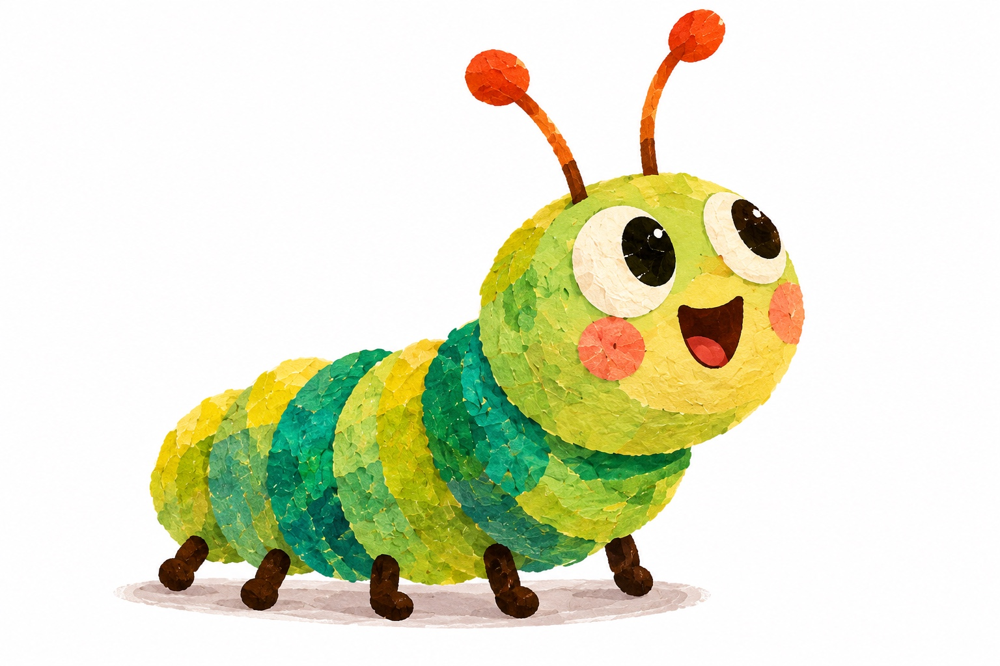
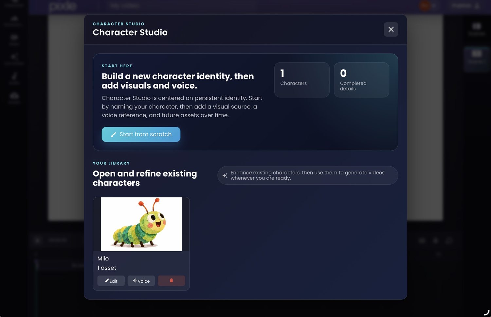
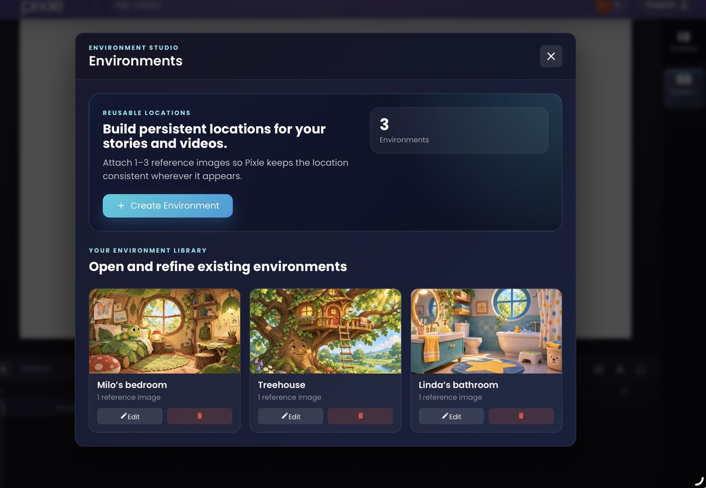
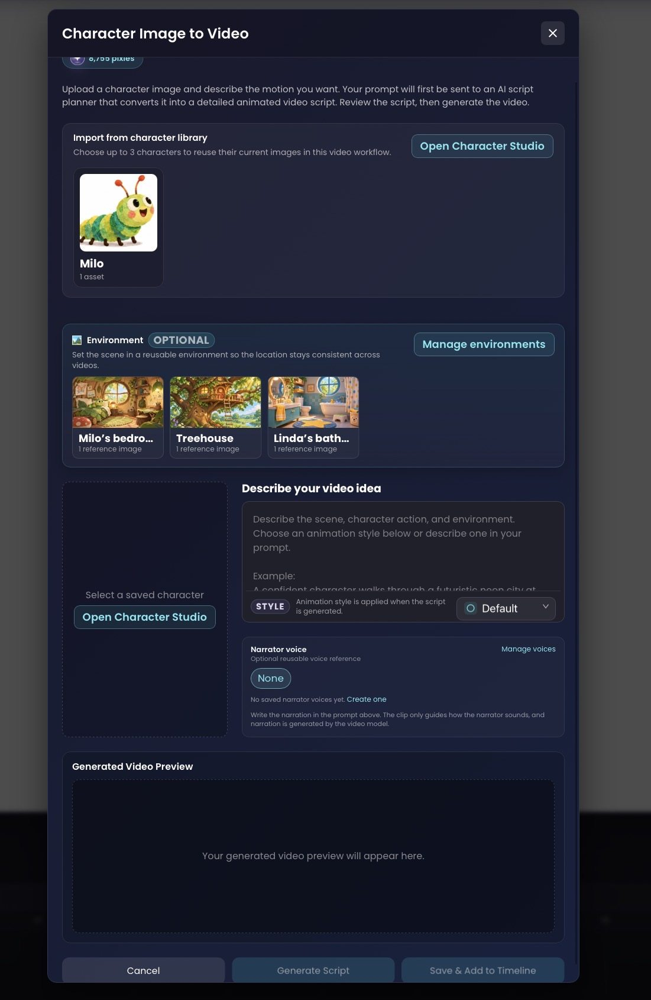
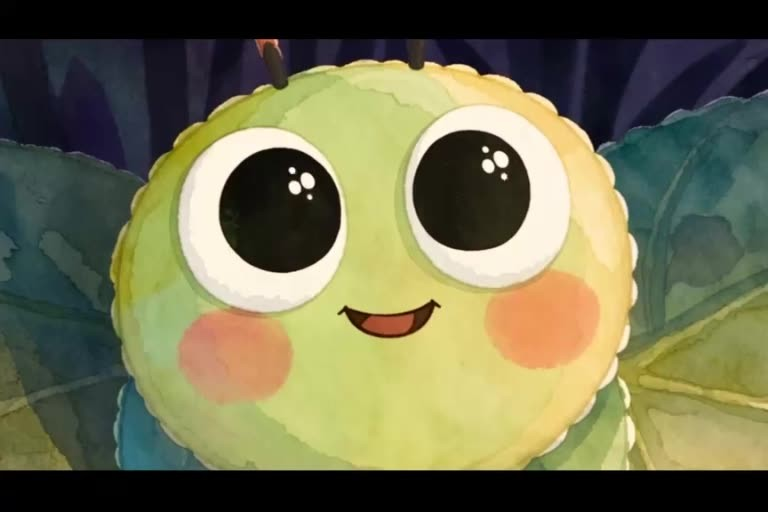
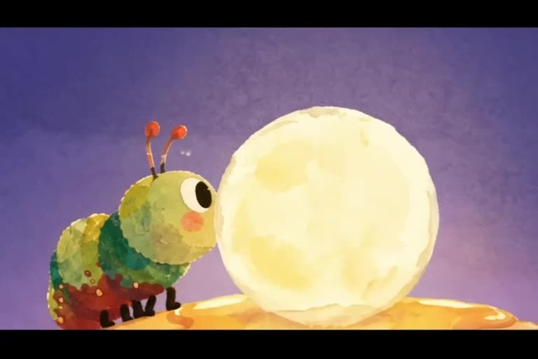
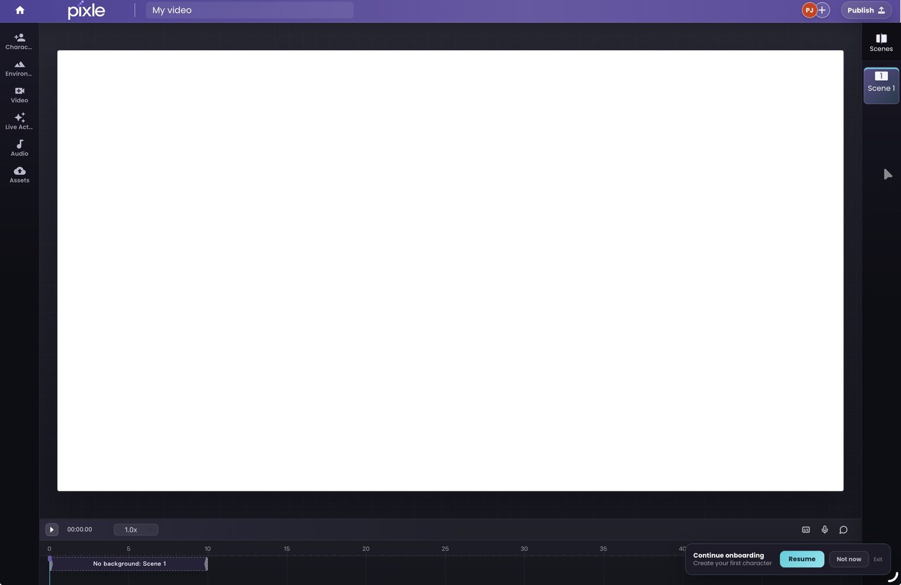
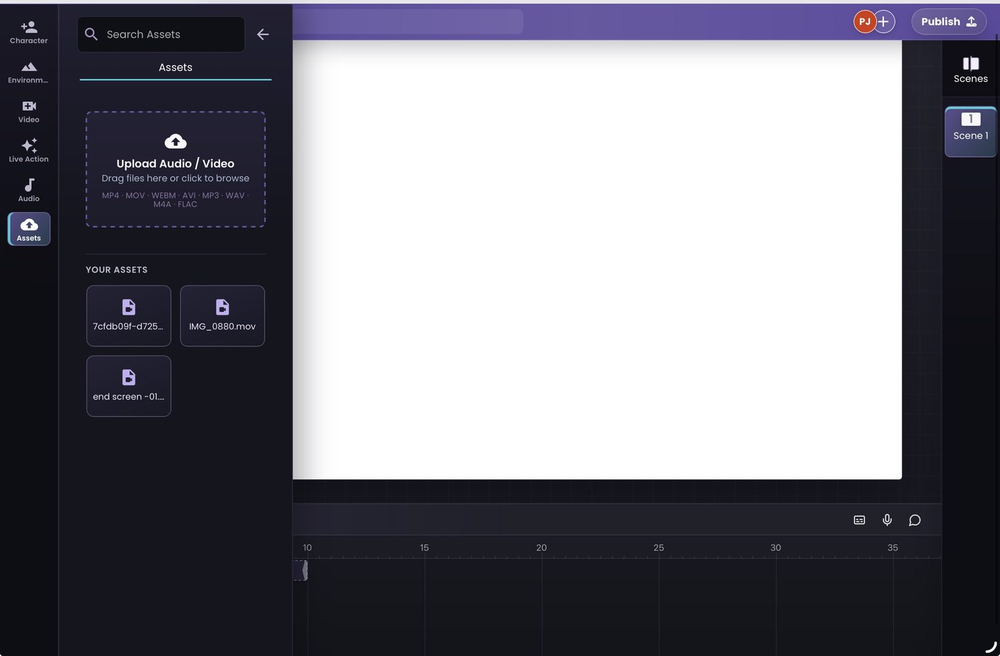

# How to Turn a Script into an Animated Video Using AI

**A practical, scene-by-scene Pixle tutorial — from your first line of dialogue to a finished animated story.**

*By the Pixle Team · Animation workflow guide · Illustrated with real Pixle screenshots and the creator-supplied Milo animation*



You have a script. It might be a children's story, a classroom lesson, a music video concept or the pilot of a YouTube cartoon. How do you turn those words into an animated video—without losing the characters, pacing and story along the way?

The trick is to **translate the script into a sequence of specific visual decisions**. An AI video tool can help generate individual shots, but it still needs to know *who is in each scene, where they are, what happens, how the camera behaves and what the audience should hear*.

In this guide we'll use [Pixle](https://www.pixle.pro/) and Milo the caterpillar to show the workflow. The example script below is an original **illustrative exercise**, not a transcript of the finished *Milo and the Missing Moon* film shown later.

## The short answer: script → shots → animation → edit

A reliable workflow has seven stages:

1. **Read the script for visual beats.** What must the audience actually see?
2. **Split it into short shots.** Give each shot one clear action and an intended duration.
3. **Prepare recurring assets.** Save the characters, environments and voice references.
4. **Describe each shot.** Combine the story action with movement, camera and style directions.
5. **Review the AI's proposed scene script.** Correct misunderstandings before generating video.
6. **Generate and inspect the scenes.** Check story clarity, character design and continuity.
7. **Edit the film.** Assemble the timeline, sound and transitions, then publish.

The important distinction: a written screenplay is **not yet a video-generation prompt**. You need a production plan between the two.

## 1. Start with a script that can be seen and heard

A basic animation script needs at least three things: what we see, what we hear and how the moment changes the story. Keep dialogue separate from actions so nothing important gets lost.

Here is a **45-second practice scene**, inspired by the theme of searching for a missing moon. It is not presented as the script used to produce the supplied Milo film.

> **INT. MILO'S BEDROOM — NIGHT**  
> Milo looks through the round window. The sky is dark.  
> **MILO:** “But the moon was right there!”  
> Milo blinks, leans closer and notices a faint glow beyond the trees.  
> **NARRATOR:** “Milo decided to follow the little light.”  
> **EXT. TREEHOUSE — NIGHT**  
> Milo arrives at the foot of the treehouse. The clouds part, revealing the moon.  
> **MILO:** “There you are!”

The script communicates the story. The next step is to turn it into clips you can actually generate and edit.

## 2. Break the script into a shot list

Instead of trying to generate the whole 45-second sequence in one instruction, divide it into manageable shots. One shot should usually communicate one main action or emotion. The durations below are **planning estimates**, not promises about clip lengths supported by any specific AI model.

| Shot | Target duration | What the viewer sees | What the viewer hears |
|---|---:|---|---|
| 1 — Establish | 6 sec | Milo in his bedroom, looking toward the round window | Gentle night ambience |
| 2 — React | 8 sec | Milo notices the missing moon and leans closer | Milo: “But the moon was right there!” |
| 3 — Discover | 11 sec | A faint glow appears beyond the garden; Milo turns to follow it | Narrator: “Milo decided to follow the little light.” |
| 4 — Resolve | 12 sec | Milo reaches the treehouse; clouds part to reveal the moon | Soft musical lift; Milo: “There you are!” |
| 5 — Hold | 8 sec | Milo smiles as moonlight warms the scene | Music resolves |

The five shots total **45 seconds of planned screen time**. In production, their actual lengths may change with the generated results, narration and editing rhythm.

[Download the companion shot-planning spreadsheet](shot-planner.csv) to build your own sequence.

**Keep each shot record specific:** character, environment, action, camera, dialogue or narration, sound and approximate duration. Those details become your generation instructions and your editing checklist.

## 3. Save your character before you start animating

Recurring characters are easier to manage when their visual identities already exist. Milo's defining details include a green-and-yellow segmented body, orange-tipped antennae, expressive eyes and a layered illustration texture.

In **Pixle Character Studio**, you can keep a named character identity in your library, attach visual assets and work with a voice reference. The screenshot below is from the actual Pixle interface, showing Milo as a saved character.



*Pixle Character Studio: save the character first, then select the same identity when animating your script's different shots.*

This matters because describing “a friendly green caterpillar” five different times leaves room for visual drift. Reusing a named reference helps preserve the character's defining features; you should still inspect each result.

For more detail, read [How to Create Consistent AI Characters Across Multiple Videos](https://www.pixle.pro/blog/consistent-ai-characters).

## 4. Choose a visual environment for each shot

The script says “Milo's bedroom” and “treehouse.” These should become reusable locations rather than unrelated backgrounds invented for each shot.

Pixle's **Environment Studio** lets creators save named locations with reference images. The library below includes Milo's bedroom and a treehouse—both directly useful for the practice script.



*Environment Studio: give each scene a consistent place to happen, especially when your story returns to a location.*

Before generation, check that the lighting, time of day and visual treatment work together. A moonlit bedroom and a moonlit treehouse should feel like they belong to the same world, even when the camera angle changes.

## 5. Turn each shot into a useful AI animation instruction

This is the step where scriptwriting becomes directing. A strong shot instruction is **specific about the action without trying to describe an entire movie**.

For Shot 2, you could give Pixle an instruction like this:

```text
CHARACTER
Use Milo from the saved character library.

ENVIRONMENT
Use Milo's bedroom from the environment library. It is nighttime.

ACTION
Milo looks out of the round window, notices that the moon
has disappeared, blinks and leans forward in surprise.

CAMERA
Start with a medium shot, then gently move closer to his face.

LOOK AND FEEL
Preserve Milo's established colour, proportions, antennae
and layered illustrated texture. Soft nighttime lighting.

AUDIO / STORY CONTEXT
Milo says: "But the moon was right there!"
Keep the performance curious, not frightened.
```

In Pixle's **Character Image to Video** workflow, select a saved character and optionally a saved environment, then describe the video idea. The interface also offers an animation-style selector and narrator-voice settings.



*Character Image to Video: combine a reusable character, location and motion instructions before making a clip.*

### Use the script-planning step deliberately

The Pixle interface explains that your instructions first go to an **AI script planner**, which prepares a more detailed animated-video script before generation. Treat this as a creative checkpoint, not a formality.

Before approving it, ask:

- Does the proposed action match the story beat?
- Are the intended characters and location correct?
- Is the camera doing one clear thing?
- Did the planner add an unwanted character, object or plot point?
- Are dialogue and narration instructions clear?

If the plan misinterprets the scene, revise your instruction before paying for another generation. Generated video and dialogue quality can vary by model and scene.

## 6. Generate, review and build the scene sequence

After generating a shot, watch it all the way through. Do not judge consistency from the first frame alone. Review the character's face, antennae, body colour, motion and the background throughout the clip.

A practical approach is to generate one representative scene first. Once its style and character treatment work, use those decisions as a reference for the remaining shots. Save the best result for each shot and record any revisions in your shot list.

For a completed animation example, watch **Milo and the Missing Moon** below. This is the creator-supplied finished film—not a claim that the five-shot practice script above was used to produce it.

[WATCH_MILO]

*Finished example: Milo and the Missing Moon (2 min 29 sec). Compare the protagonist, mood, composition and pacing across the film.*



*Close-up: a good test of facial features and performance.*



*Wider composition: a good test of the character's recognisability across shots.*

## 7. Edit the video: timing, sound and final polish

Once you have usable clips, bring them into a timeline in script order. The **Pixle Creative Editor** provides a preview canvas, scene controls and a timeline for arranging shots and managing pacing.



*Pixle Creative Editor: the interface for assembling and refining the sequence. This screenshot shows an empty project, not a finished edit.*

At this point, ask whether each cut advances the story. A surprised reaction may need an extra beat; an establishing shot might need to be shortened. Use dialogue, narration, sound effects and music to support the visual storytelling—not to explain a confusing scene after the fact.

You can also bring supporting media into the **Assets** panel, which shows audio and video upload controls alongside stored files.



*Assets panel: organise supporting audio and video resources for your edit.*

### Final checks before publishing

- **Story:** Does the beginning set up a clear question, and does the ending answer it?
- **Continuity:** Does Milo keep his recognisable look from shot to shot?
- **Audio:** Can viewers understand the dialogue and hear a consistent voice?
- **Timing:** Does the edit leave enough time for important reactions and reveals?
- **Rights:** Do you have permission to use all included characters, references, music, audio and imagery?
- **Export:** Does the video have the correct aspect ratio, resolution and sound for its destination?

Pixle's website also describes **direct YouTube publishing**, including video metadata and audience settings. Check the Publish flow available in your account; alternatively, export the completed video for the destination platform.

## Common mistakes when turning a script into AI animation

**Generating the whole script as a single prompt.** The model may improvise important story beats. Shorter, well-defined shots are easier to inspect and arrange.

**Writing only dialogue.** Animation needs visible actions and reactions, not just spoken words. Give each line a performance and a camera perspective.

**Changing character descriptions between scenes.** Use the same saved identities and reference images instead of reinventing the design.

**Skipping the rough edit.** Individual clips can look attractive but feel disconnected together. Check timing and continuity in sequence.

**Assuming every generation will be right on the first try.** Leave room for creative review, iteration and costs that depend on your selected generation model and plan.

## Frequently asked questions

### Can I animate a script with AI even if I can't draw?

Yes. You can prepare a story, split it into shots, use visual references and direct an AI animation workflow without hand-drawing every frame. Clear storytelling and creative review are still essential.

### Should I generate an entire episode in one go?

For most narrative workflows, separate shots make it easier to control actions, characters, camera angles and pacing. Assemble the results after inspecting them.

### How do I make the character look the same in every scene?

Keep a consistent visual reference, use saved character identities and review generated outputs side by side. Pixle's Character Studio is intended to support reusable characters across scenes and episodes.

### Can I add narration and sound effects?

Pixle's visible workflow includes narrator voice settings, and its editor and Assets panel support sound and media work. How you time or revise a particular audio element will depend on the workflow and generation method you use.

### How much does it cost to animate a script with AI?

Cost depends on scene duration, generation model, number of attempts and editing needs. A short shot list helps you estimate the work before committing to a full-length video. Check the current Pixle plans and generation costs in the app rather than relying on a fixed per-minute claim.

## Turn your next script into an animated story

If your story already exists on the page, the next step is to create a visual plan that preserves its characters, world and creative intent. Pixle brings saved characters, environments, AI-assisted scene generation and an editing timeline into one workspace.

**[Start creating with Pixle](https://app.pixle.pro/?utm_source=blog&utm_medium=article&utm_campaign=script_to_animation)**

**Related guides:** [How to Create Consistent AI Characters Across Multiple Videos](https://www.pixle.pro/blog/consistent-ai-characters) · [How to Make an Animated YouTube Series Using AI](https://www.pixle.pro/blog/ai-animated-youtube-series)

---

**About the author:** The Pixle Team builds an AI-native animation workspace for creators making recurring characters, story worlds and animated videos. This guide uses real product screenshots, an original sample scene, and the supplied *Milo and the Missing Moon* animation. The example script and shot timings are illustrative.
